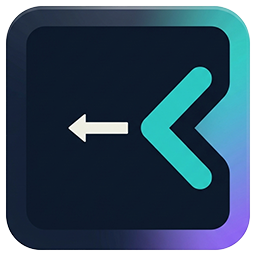
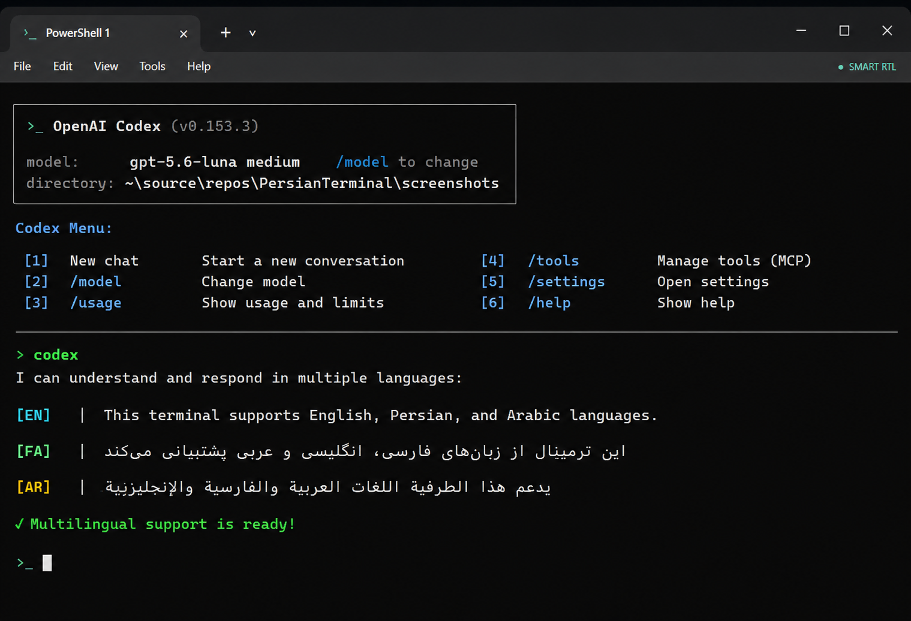

<div align="center">
  
  <h1>Rtl Terminal</h1>
  <p>A Windows terminal built for Persian, Arabic and mixed-direction text.</p>
  <p>ترمینال ویندوز برای فارسی، عربی و متن‌های ترکیبی راست‌به‌چپ و چپ‌به‌راست</p>
  <p>طرفية لويندوز تدعم العربية والفارسية والنصوص المختلطة الاتجاه</p>
  <p><a href="#english">English</a> · <a href="#فارسی">فارسی</a> · <a href="#العربية">العربية</a></p>
  <p><strong><a href="https://github.com/mirbehnam/RtlTerminal/releases/latest">Download for Windows · دانلود برای ویندوز · تنزيل لويندوز</a></strong></p>
  <p><a href="https://mirbehnam.github.io/RtlTerminal/">Website</a> · <a href="https://github.com/mirbehnam/RtlTerminal/issues">Report an issue</a> · <a href="LICENSE">GPLv3</a></p>
  
</div>

## English

**Rtl Terminal** is an open-source terminal emulator for Windows by **behnamapps**. It brings readable Persian and Arabic text to PowerShell, Command Prompt and WSL, with Smart RTL handling mixed text, numbers and punctuation alongside terminal colors and interactive applications.

### Install

Download `RtlTerminal-Setup-…-x64.exe` from the [latest release](https://github.com/mirbehnam/RtlTerminal/releases/latest) and run the installer.

- **Windows:** Windows 10 version 2004 (build 19041) or later, including Windows 11.
- **Architecture:** x64.
- **Runtime:** included in the installer; no separate .NET installation needed.

### Features

- **Readable mixed text.** Smart RTL displays Persian, Arabic and English together, with word wrapping and ANSI, 256-color and true-color support.
- **Tabs and split panes.** Run PowerShell, Command Prompt and installed WSL distributions; split the active pane, combine tabs, rename them and assign tab colors.
- **Terminal macros.** Record commands and interactive keys, edit steps and replay with pause, resume or single-step controls. Files are encrypted, with optional password protection and sensitive inputs requested at runtime.
- **Directory history.** See the active pane's folder, open it in Explorer and revisit recent locations. The menu shows 20 directories; searchable history holds up to 200 and can be cleared or disabled.
- **Personalization.** Preview light and dark themes, customize installed fonts and choose English, Persian or Arabic interface text without changing the layout direction.
- **Output and sharing.** Open a local HTML preview of the current page, recent content or retained history, or export the session as UTF-8 text.
- **Desktop integration.** Copy and paste, drop files or images into a pane, open links with Ctrl+click and optionally add “Open in RtlTerminal” to the Windows folder context menu.

### Getting started

Use **+** to open a terminal and its adjacent arrow to choose a profile. Right-click a tab for split and color options; double-click its name to rename it.

Open **Edit → Settings** for fonts, themes, history and macro preferences. **Help → LANGUAGE** changes the interface language. The eye button on the toolbar opens the browser preview.

| Action | Shortcut |
| --- | --- |
| New tab | `Ctrl+Shift+T` |
| Next / previous tab | `Ctrl+Tab` / `Ctrl+Shift+Tab` |
| Split active pane | `Ctrl+Shift+D` |
| Switch panes | `Ctrl+Shift+Left` / `Ctrl+Shift+Right` |
| Close active pane or tab | `Ctrl+Shift+W` |
| Copy selection | `Ctrl+C` / `Ctrl+Shift+C` |
| Paste | `Ctrl+V` / `Ctrl+Shift+V` |
| Open a link | `Ctrl+click` |

With no text selected, `Ctrl+C` interrupts the running command. Pane shortcuts can be disabled in Settings.

### Guides and support

[Macros](docs/macros.md) · [Directory history](docs/directory-history.md) · [WSL](docs/wsl-behavior.md) · [Interface languages](docs/ui-language.md)

For rendering issues, include your Windows version, shell, command, expected result and a screenshot in an [issue](https://github.com/mirbehnam/RtlTerminal/issues). Smart RTL handles automatically wrapped text; application-defined line breaks and full-screen terminal layouts are preserved. Rendering can vary between CLI applications.

## فارسی

**Rtl Terminal** ترمینالی متن‌باز برای ویندوز از **behnamapps** است که خواندن متن فارسی و عربی را در PowerShell، Command Prompt و WSL آسان‌تر می‌کند. قابلیت Smart RTL نمایش متن‌های ترکیبی، اعداد و نشانه‌ها را در کنار رنگ‌ها و برنامه‌های تعاملی ترمینال مدیریت می‌کند.

### نصب

فایل `RtlTerminal-Setup-…-x64.exe` را از [آخرین انتشار](https://github.com/mirbehnam/RtlTerminal/releases/latest) دریافت و اجرا کنید.

- **سیستم‌عامل:** ویندوز ۱۰ نسخهٔ ۲۰۰۴، بیلد ۱۹۰۴۱ یا جدیدتر؛ شامل ویندوز ۱۱.
- **معماری:** x64.
- **پیش‌نیاز:** نصب‌کننده شامل محیط اجرای .NET است و به نصب جداگانهٔ آن نیاز ندارد.

### قابلیت‌ها

- **نمایش خوانای متن ترکیبی:** پشتیبانی از فارسی، عربی و انگلیسی در کنار هم، انتقال کلمات به خط بعد و رنگ‌های ANSI، پالت ۲۵۶‌رنگ و True Color.
- **تب‌ها و پنل‌های مجزا:** اجرای PowerShell، Command Prompt و توزیع‌های نصب‌شدهٔ WSL، تقسیم پنل فعال، ترکیب تب‌ها، تغییر نام و رنگ تب.
- **ماکروهای ترمینال:** ضبط فرمان‌ها و کلیدهای تعاملی، ویرایش مراحل و اجرای مجدد با امکان مکث، ادامه و اجرای گام‌به‌گام. فایل‌ها رمزگذاری می‌شوند و می‌توان برایشان رمز مستقل تعیین کرد یا ورودی‌های حساس را هنگام اجرا پرسید.
- **تاریخچهٔ پوشه‌ها:** نمایش پوشهٔ پنل فعال، بازکردن آن در اکسپلورر و بازگشت به مسیرهای اخیر. منو ۲۰ مسیر و پنجرهٔ جست‌وجو تا ۲۰۰ مسیر را نمایش می‌دهد؛ تاریخچه قابل پاک‌کردن و غیرفعال‌کردن است.
- **شخصی‌سازی محیط:** تم‌های روشن و تیره با پیش‌نمایش، تنظیم فونت‌های نصب‌شده و رابط فارسی، انگلیسی یا عربی بدون تغییر جهت چیدمان.
- **ذخیره و نمایش خروجی:** پیش‌نمایش HTML محلی از صفحهٔ فعلی، محتوای اخیر یا کل سابقهٔ نگه‌داری‌شده و ذخیرهٔ جلسه به‌صورت متن UTF-8.
- **هماهنگی با دسکتاپ:** کپی و پیست، کشیدن فایل یا تصویر روی پنل، بازکردن لینک با Ctrl و کلیک و افزودن اختیاری «Open in RtlTerminal» به منوی راست‌کلیک پوشه‌های ویندوز.

### شروع کار

با دکمهٔ **+** یک ترمینال باز کنید و با فلش کنارش محیط موردنظر را انتخاب کنید. گزینه‌های تقسیم و رنگ در راست‌کلیک تب قرار دارند؛ برای تغییر نام، روی نام تب دوبار کلیک کنید.

تنظیمات فونت، تم، تاریخچه و ماکرو در **Edit → Settings** قرار دارند. زبان رابط از **Help → LANGUAGE** تغییر می‌کند و دکمهٔ چشم در نوار بالا پیش‌نمایش مرورگر را باز می‌کند.

| کار | میان‌بر |
| --- | --- |
| تب جدید | `Ctrl+Shift+T` |
| تب بعدی / قبلی | `Ctrl+Tab` / `Ctrl+Shift+Tab` |
| تقسیم پنل فعال | `Ctrl+Shift+D` |
| جابه‌جایی بین پنل‌ها | `Ctrl+Shift+Left` / `Ctrl+Shift+Right` |
| بستن پنل یا تب فعال | `Ctrl+Shift+W` |
| کپی متن انتخاب‌شده | `Ctrl+C` / `Ctrl+Shift+C` |
| پیست | `Ctrl+V` / `Ctrl+Shift+V` |
| بازکردن لینک | `Ctrl` و کلیک |

اگر متنی انتخاب نشده باشد، `Ctrl+C` فرمان جاری را متوقف می‌کند. میان‌برهای پنل‌ها در تنظیمات قابل غیرفعال‌کردن‌اند.

### راهنما و پشتیبانی

[ماکروها](docs/macros.md) · [تاریخچهٔ پوشه‌ها](docs/directory-history.md) · [رفتار WSL](docs/wsl-behavior.md) · [زبان رابط](docs/ui-language.md)

برای گزارش مشکل، نسخهٔ ویندوز، محیط خط فرمان، فرمان اجراشده، نتیجهٔ مورد انتظار و تصویر مشکل را در بخش [Issues](https://github.com/mirbehnam/RtlTerminal/issues) بفرستید. Smart RTL شکست خودکار خطوط را مدیریت می‌کند؛ شکست خط‌های صریح و چیدمان برنامه‌های تمام‌صفحه حفظ می‌شوند. نتیجهٔ نمایش ممکن است بین ابزارهای خط فرمان متفاوت باشد.

## العربية

**Rtl Terminal** هو محاكي طرفية مفتوح المصدر لنظام Windows من **behnamapps**، يساعد على قراءة العربية والفارسية في PowerShell وCommand Prompt وWSL. تتولى ميزة Smart RTL عرض النصوص المختلطة والأرقام وعلامات الترقيم، إلى جانب ألوان الطرفية والتطبيقات التفاعلية.

### التثبيت

نزّل الملف `RtlTerminal-Setup-…-x64.exe` من [أحدث إصدار](https://github.com/mirbehnam/RtlTerminal/releases/latest) وشغّل المثبّت.

- **النظام:** Windows 10 الإصدار 2004، البناء 19041 أو أحدث، بما في ذلك Windows 11.
- **المعمارية:** x64.
- **بيئة التشغيل:** مضمّنة في المثبّت؛ لا حاجة إلى تثبيت .NET بشكل منفصل.

### المميزات

- **نصوص مختلطة واضحة:** العربية والفارسية والإنجليزية مع التفاف الكلمات ودعم ألوان ANSI و256 لوناً والألوان الحقيقية.
- **علامات تبويب وأجزاء مستقلة:** تشغيل PowerShell وCommand Prompt وتوزيعات WSL المثبّتة، مع تقسيم الجزء النشط ودمج العلامات وتغيير أسمائها وألوانها.
- **ماكرو الطرفية:** تسجيل الأوامر والمفاتيح التفاعلية، وتحرير الخطوات وإعادة تشغيلها مع الإيقاف المؤقت والمتابعة والتنفيذ خطوة بخطوة. تُشفّر الملفات مع كلمة مرور اختيارية وإمكانية طلب المدخلات الحساسة أثناء التشغيل.
- **سجل المجلدات:** عرض مجلد الجزء النشط وفتحه في المستكشف والعودة إلى المجلدات الأخيرة. تعرض القائمة 20 موقعاً، وتتيح نافذة البحث الوصول إلى 200 موقع مع مسح السجل أو تعطيله.
- **التخصيص:** سمات فاتحة وداكنة مع معاينة، وإعدادات للخطوط المثبّتة، وواجهة عربية أو فارسية أو إنجليزية دون تغيير اتجاه التخطيط.
- **حفظ المخرجات وعرضها:** معاينة HTML محلية للصفحة الحالية أو المحتوى الأخير أو السجل المحتفظ به، وتصدير الجلسة كنص UTF-8.
- **التكامل مع سطح المكتب:** النسخ واللصق وإفلات الملفات والصور على الجزء وفتح الروابط باستخدام Ctrl مع النقر، وإضافة خيار «Open in RtlTerminal» إلى قائمة المجلدات اختيارياً.

### البدء

استخدم زر **+** لفتح طرفية والسهم المجاور لاختيار البيئة. انقر بزر الفأرة الأيمن على علامة التبويب لخيارات التقسيم واللون، أو انقر مرتين على اسمها لإعادة تسميتها.

توجد إعدادات الخط والسمات والسجل والماكرو في **Edit → Settings**. غيّر لغة الواجهة من **Help → LANGUAGE**، وافتح معاينة المتصفح بزر العين في شريط الأدوات.

| الإجراء | الاختصار |
| --- | --- |
| علامة تبويب جديدة | `Ctrl+Shift+T` |
| العلامة التالية / السابقة | `Ctrl+Tab` / `Ctrl+Shift+Tab` |
| تقسيم الجزء النشط | `Ctrl+Shift+D` |
| التنقل بين الأجزاء | `Ctrl+Shift+Left` / `Ctrl+Shift+Right` |
| إغلاق الجزء أو العلامة النشطة | `Ctrl+Shift+W` |
| نسخ النص المحدد | `Ctrl+C` / `Ctrl+Shift+C` |
| اللصق | `Ctrl+V` / `Ctrl+Shift+V` |
| فتح رابط | `Ctrl` مع النقر |

عند عدم تحديد نص، يرسل `Ctrl+C` مقاطعة للأمر الجاري. يمكن تعطيل اختصارات الأجزاء من الإعدادات.

### الأدلة والدعم

[الماكرو](docs/macros.md) · [سجل المجلدات](docs/directory-history.md) · [سلوك WSL](docs/wsl-behavior.md) · [لغات الواجهة](docs/ui-language.md)

للإبلاغ عن مشكلة، أرفق إصدار Windows والصدفة والأمر والنتيجة المتوقعة وصورة للمشكلة في [Issues](https://github.com/mirbehnam/RtlTerminal/issues). تتعامل Smart RTL مع التفاف الأسطر التلقائي مع الحفاظ على فواصل الأسطر الصريحة وتخطيط التطبيقات بملء الشاشة. قد تختلف نتائج العرض بين أدوات سطر الأوامر.

---

## Development

Build on Windows with the **.NET 8 SDK**, or open `RtlTerminal.sln` in Visual Studio 2022 with WPF support.

```powershell
git clone https://github.com/mirbehnam/RtlTerminal.git
cd RtlTerminal
dotnet build RtlTerminal.sln -c Release
dotnet run --project src/RtlTerminal/RtlTerminal.csproj
```

To create a self-contained build, run `./scripts/build-release.ps1`. With **Inno Setup 6** available on PATH, it also creates the installer. Keep the adjacent `ConPty` folder with the executable when distributing a portable build.

[Build, tests and repository layout](docs/project-layout.md) · [Renderer internals](docs/renderer.md) · [WinGet distribution](docs/winget.md) · [Security policy](SECURITY.md)

Bug reports, translations and pull requests are welcome.

## License

Created by **Behnam Tajadini · behnamapps**. Licensed under the [GNU General Public License v3](LICENSE).
